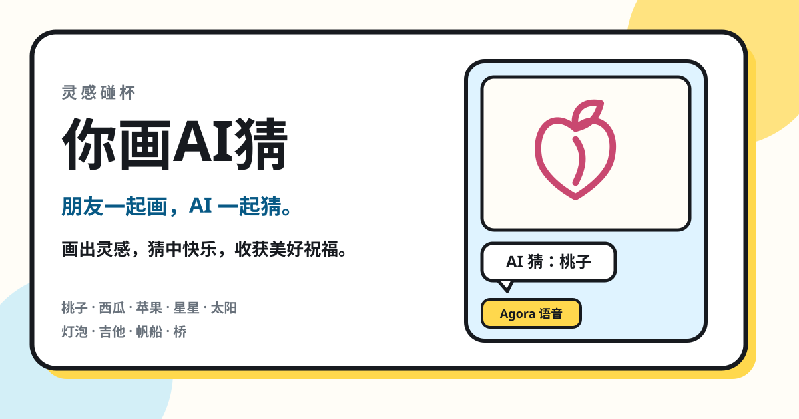
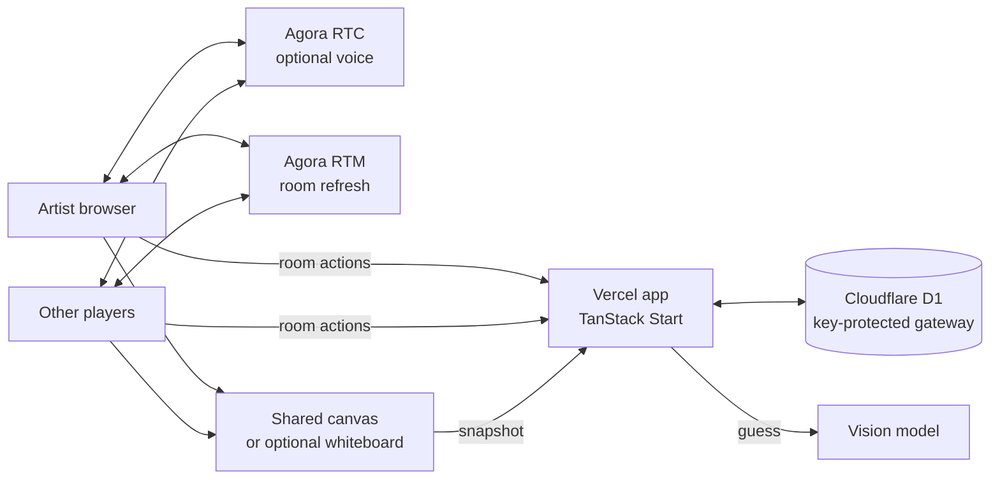

<div align="center">


# 你画AI猜

**You draw. AI guesses.**

A Chinese multiplayer drawing game. Friends take turns sketching, and a real
player and an AI drawing friend guess the same picture. The AI only sees the
shared canvas and its earlier guesses.

[](./LICENSE)


**English** · [简体中文](./README.zh-CN.md)

[Play the live demo](https://agora-draw-guess.vercel.app)

</div>

---

你画AI猜 is a browser party game: one person draws, everyone else guesses, and
an AI player guesses from the same sketch. A correct guess wins the round.
Each of the nine topics then reveals a drink name and a short wish.

The interface is Simplified Chinese. You can play alone with the AI, or invite
friends into a six-digit room.



The hosted demo may ask for an access password if the operator set one. A local
checkout stays open unless you set that password yourself.

## Architecture



Runtime roles:

- **Vercel app:** rooms, turns, timers, seat checks, scoring, and vision calls.
- **Cloudflare D1:** rooms, seats, rounds, guesses, and scores. Browsers never
  talk to the database. A Worker accepts batched SQL only with a server key.
- **Shared canvas:** the default board. The artist draws, snapshots sync to the
  room, and only those snapshots go to the vision model.
- **Vision model:** DeepSeek `deepseek-flash` by default. It must choose one of
  the nine topics, or “未知”. It does not receive the selected topic, drink
  name, or wish.
- **Agora RTC / RTM:** optional voice and low-latency room refresh. Game state
  stays in D1.
- **Agora Interactive Whiteboard:** optional. Without those credentials, the
  built-in canvas is used.

## Features

- Solo play with the AI, or a room for friends. The AI sits in by default.
- Six-digit room codes, 1 / 3 / 5 rounds, and 45 / 60 / 90 second turns.
- The artist picks one of three topics, then draws. Writing the answer is not
  the point of the round.
- Humans and the AI share one win. The first correct guess scores; the artist
  receives an assist score. Solo games hide the scoreboard.
- New strokes can trigger a vision guess about every 2.5 seconds. A blank
  canvas does not.
- Earlier AI guesses are sent back as context. Drink names and wishes are not.
- Optional Agora voice. The microphone stays off until a player joins voice.
- Host transfer, reconnect, and a new game after the last round.
- A three-step guide before the first start. Leaving a live game asks for
  confirmation.

## Topics

| Topic | Drink | Wish |
| --- | --- | --- |
| 桃子 | 桃桃欢喜 | 愿你的日子像桃子一样，甜一点，再甜一点。 |
| 西瓜 | 西瓜假日 | 忙里偷个闲，把今天过成一个小假期。 |
| 苹果 | 苹果微甜 | 平平安安，也有小小的惊喜，这样的日子就很好。 |
| 星星 | 今晚有星 | 悄悄许个愿吧，愿你期待的好事慢慢发生。 |
| 太阳 | 满杯阳光 | 愿今天的好心情，陪你走过接下来的每一天。 |
| 灯泡 | 一点灵感 | 有了好点子就试试看，说不定惊喜就从这里开始。 |
| 吉他 | 夏夜小调 | 愿你有喜欢的歌，也有愿意陪你听歌的人。 |
| 帆船 | 一路顺风 | 去想去的地方吧，愿一路有好风，也有好风景。 |
| 桥 | 美好相逢 | 很高兴在这里遇见你，愿下次见面也有好事分享。 |

Topic copy lives in [`src/lib/game/topics.ts`](./src/lib/game/topics.ts).

## Quick Start

### Requirements

- Node.js 22 or newer
- pnpm 11
- A Cloudflare account with Workers and D1
- An OpenAI API key, or an OpenAI-compatible vision API
- An Agora project only if you want voice or Interactive Whiteboard

### 1. Install

```bash
git clone https://github.com/zicojiao/agora-draw-guess.git
cd agora-draw-guess
pnpm install
cp .env.example .env.local
cp infrastructure/d1/wrangler.example.jsonc infrastructure/d1/wrangler.jsonc
```

Put real credentials in `.env.local` or deployment secrets. Do not prefix server
secrets with `VITE_`. Vite exposes every `VITE_` variable to the browser.

### 2. Create the database

The example Wrangler file uses a placeholder D1 id. Create your own database,
put its id in the ignored `infrastructure/d1/wrangler.jsonc`, then apply the
schema. Install the Wrangler CLI if you do not already have it.

```bash
pnpm dlx wrangler d1 create agora-draw-guess-db
pnpm dlx wrangler d1 execute agora-draw-guess-db --remote --file migrations/0001_draw_and_guess.sql --config infrastructure/d1/wrangler.jsonc
pnpm dlx wrangler deploy --config infrastructure/d1/wrangler.jsonc
pnpm dlx wrangler secret put DATABASE_SERVICE_KEY --config infrastructure/d1/wrangler.jsonc
```

Generate the key first:

```bash
openssl rand -hex 32
```

Use that same value for the Worker secret and for `DATABASE_SERVICE_KEY` in
`.env.local`. Set `DATABASE_SERVICE_URL` to the deployed Worker URL.

For a fully local database, apply the migration with `--local` and run
`pnpm dlx wrangler dev --config infrastructure/d1/wrangler.jsonc`, then point
`DATABASE_SERVICE_URL` at that local Worker, usually `http://127.0.0.1:8787`.

### 3. Configure the app

Fill `.env.local`:

```bash
VITE_PUBLIC_SITE_URL=http://localhost:3000
DATABASE_SERVICE_URL=
DATABASE_SERVICE_KEY=
OPENAI_API_KEY=
AI_API_BASE_URL=https://api.deepseek.com
OPENAI_VISION_MODEL=deepseek-flash
```

Voice is optional:

```bash
AGORA_APP_ID=
AGORA_APP_CERTIFICATE=
```

Interactive Whiteboard is optional. Leave it empty to keep the built-in canvas:

```bash
AGORA_WHITEBOARD_APP_IDENTIFIER=
AGORA_WHITEBOARD_ACCESS_KEY=
AGORA_WHITEBOARD_SECRET_KEY=
AGORA_WHITEBOARD_REGION=us-sv
```

An access password is also optional. Set both values to gate the whole site.
Leave both empty for a normal local game. Generate `ACCESS_COOKIE_SECRET` with
`openssl rand -hex 32`.

```bash
ACCESS_PASSWORD=
ACCESS_COOKIE_SECRET=
```

`OPENAI_API_KEY` is the key for `AI_API_BASE_URL`. The default host is DeepSeek,
and the server calls `https://api.deepseek.com/chat/completions` with
`deepseek-flash`, which accepts the canvas image. If the base URL contains
`api.openai.com`, the server uses the Responses API instead. Any other host
must accept OpenAI-style chat completions and return JSON.

### 4. Run

```bash
pnpm dev
```

Open [http://localhost:3000](http://localhost:3000). Create a room, draw one of
the nine topics, and watch the AI guess. Open the room code in another browser
profile to play with a second person.

## Deployment

App, on Vercel:

```bash
vercel link
vercel env add VITE_PUBLIC_SITE_URL production
vercel env add DATABASE_SERVICE_URL production
vercel env add DATABASE_SERVICE_KEY production
vercel env add OPENAI_API_KEY production
vercel env add AI_API_BASE_URL production
vercel env add OPENAI_VISION_MODEL production
vercel deploy --prod
```

Add Agora, whiteboard, and access-password variables only when you use them.
`vercel.json` builds this app as TanStack Start and pins the function region
to `sin1`.

The D1 Worker stays on Cloudflare. Browsers never receive `DATABASE_SERVICE_KEY`.

Rooms last four hours. Creating a room also clears expired rooms. Only the
current artist can upload a drawing. Guessers do not receive the answer until
the round ends.

## Checks

```bash
pnpm test
pnpm typecheck
pnpm build
```

`pnpm verify` runs all three. Normal tests do not call a paid vision API.
[`tests/vision/README.md`](./tests/vision/README.md) describes an explicit
evaluation run that reads `.env.local` locally and must not be committed with
player drawings.

## Project Layout

```text
src/routes/              Pages and game HTTP handlers
src/components/          Home, room, canvas, guide, and rules
src/lib/game/            Topics, drawing sync, AI guess queue, scoring rules
src/lib/server/          Room authority, vision calls, access gate, database client
infrastructure/d1/       Cloudflare Worker that guards D1
migrations/              D1 schema
public/                  Icons, manifest, and offline page
```

## Roadmap

- [ ] More topics, and a way for a host to bring their own word list.
- [ ] Shorter time from a new stroke to the AI guess.
- [ ] An English play mode beside the Chinese one.

## License

[MIT](./LICENSE)
