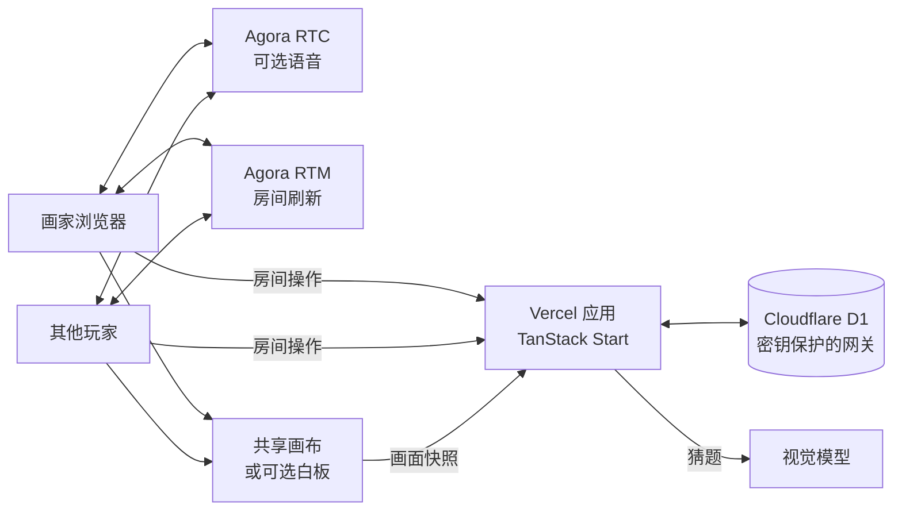

<div align="center">


# 你画AI猜

**你来画，AI 来猜。**

中文多人绘画游戏。朋友轮流作画，真人和 AI 画友看同一张图来猜。AI 只接收共享画面和它之前的猜测。

[](./LICENSE)


[English](./README.md) · **简体中文**

[打开线上演示](https://agora-draw-guess.vercel.app)

</div>

---

你画AI猜是一个浏览器聚会游戏：一个人画，其他人猜，AI 画友也根据同一张画来猜。猜对就赢下这一轮。九个题目各自对应一款酒名和一句祝福。

界面是简体中文。可以一个人跟 AI 玩，也可以用六位数字房间号邀请朋友。


如果部署者设置了访问密码，线上演示会先要求输入密码。本地仓库默认不设密码，游戏直接打开。

## 架构



运行角色：

- **Vercel 应用：** 房间、回合、倒计时、席位校验、积分和视觉模型调用。
- **Cloudflare D1：** 保存房间、席位、回合、猜测和积分。浏览器不能直接访问数据库。Worker 只接受带服务端密钥的批量 SQL。
- **共享画布：** 默认画板。画家作画，快照同步给房间，只有这些快照会送给视觉模型。
- **视觉模型：** 默认使用 DeepSeek `deepseek-flash`。它只能从九个题目里选一个，或回答「未知」。它不会收到本轮选题、酒名或祝福。
- **Agora RTC / RTM：** 可选的实时语音和低延迟房间刷新。游戏状态仍以 D1 为准。
- **Agora Interactive Whiteboard：** 可选。没有这组凭证时使用内置画布。

## 功能

- 可以和 AI 单人玩，也可以开房间邀请朋友。AI 画友默认在场。
- 六位数字房间号，1 / 3 / 5 轮，每轮 45 / 60 / 90 秒。
- 画家从三个题目里选一个再画。这一轮不是用来把答案写在画板上的。
- 真人和 AI 争夺同一次猜中。最先猜对的人得分，画家获得协作分。只有你和 AI 时不显示积分榜。
- 画出新内容后，大约每 2.5 秒最多发起一次识图。空白画布不会触发。
- 之前的 AI 猜测会作为上下文送回。酒名和祝福不会送出。
- 可选 Agora 语音。只有玩家主动加入语音后才会打开麦克风。
- 支持房主移交、断线重连，以及终局后重新开一局。
- 第一次开始前有三步引导。进行中的对局退出时会先确认。

## 题目

| 题目 | 酒名 | 祝福 |
| --- | --- | --- |
| 桃子 | 桃桃欢喜 | 愿你的日子像桃子一样，甜一点，再甜一点。 |
| 西瓜 | 西瓜假日 | 忙里偷个闲，把今天过成一个小假期。 |
| 苹果 | 苹果微甜 | 平平安安，也有小小的惊喜，这样的日子就很好。 |
| 星星 | 今晚有星 | 悄悄许个愿吧，愿你期待的好事慢慢发生。 |
| 太阳 | 满杯阳光 | 愿今天的好心情，陪你走过接下来的每一天。 |
| 灯泡 | 一点灵感 | 有了好点子就试试看，说不定惊喜就从这里开始。 |
| 吉他 | 夏夜小调 | 愿你有喜欢的歌，也有愿意陪你听歌的人。 |
| 帆船 | 一路顺风 | 去想去的地方吧，愿一路有好风，也有好风景。 |
| 桥 | 美好相逢 | 很高兴在这里遇见你，愿下次见面也有好事分享。 |

题目文案在 [`src/lib/game/topics.ts`](./src/lib/game/topics.ts)。

## 快速开始

### 环境

- Node.js 22 或更新版本
- pnpm 11
- 带 Workers 和 D1 的 Cloudflare 账号
- OpenAI API key，或兼容 OpenAI 的视觉接口
- 只有需要语音或互动白板时才要 Agora 项目

### 1. 安装

```bash
git clone https://github.com/zicojiao/agora-draw-guess.git
cd agora-draw-guess
pnpm install
cp .env.example .env.local
cp infrastructure/d1/wrangler.example.jsonc infrastructure/d1/wrangler.jsonc
```

真实凭证放在 `.env.local` 或部署平台的密钥里。服务端密钥不要使用 `VITE_` 前缀。Vite 会把所有 `VITE_` 变量打进浏览器。

### 2. 创建数据库

示例 Wrangler 配置里的 D1 id 是占位符。创建自己的数据库，把 id 写进被 Git 忽略的 `infrastructure/d1/wrangler.jsonc`，再执行迁移。还没有 Wrangler CLI 的话，下面的命令会临时拉起它。

```bash
pnpm dlx wrangler d1 create agora-draw-guess-db
pnpm dlx wrangler d1 execute agora-draw-guess-db --remote --file migrations/0001_draw_and_guess.sql --config infrastructure/d1/wrangler.jsonc
pnpm dlx wrangler deploy --config infrastructure/d1/wrangler.jsonc
pnpm dlx wrangler secret put DATABASE_SERVICE_KEY --config infrastructure/d1/wrangler.jsonc
```

先生成密钥：

```bash
openssl rand -hex 32
```

Worker 密钥和 `.env.local` 里的 `DATABASE_SERVICE_KEY` 使用同一个值。`DATABASE_SERVICE_URL` 填部署后的 Worker 地址。

如果只想在本机使用数据库，用 `--local` 执行迁移，再运行 `pnpm dlx wrangler dev --config infrastructure/d1/wrangler.jsonc`，把 `DATABASE_SERVICE_URL` 指到这个本地 Worker，通常是 `http://127.0.0.1:8787`。

### 3. 配置应用

填写 `.env.local`：

```bash
VITE_PUBLIC_SITE_URL=http://localhost:3000
DATABASE_SERVICE_URL=
DATABASE_SERVICE_KEY=
OPENAI_API_KEY=
AI_API_BASE_URL=https://api.deepseek.com
OPENAI_VISION_MODEL=deepseek-flash
```

语音是可选的：

```bash
AGORA_APP_ID=
AGORA_APP_CERTIFICATE=
```

互动白板也是可选的。留空就继续使用内置画布：

```bash
AGORA_WHITEBOARD_APP_IDENTIFIER=
AGORA_WHITEBOARD_ACCESS_KEY=
AGORA_WHITEBOARD_SECRET_KEY=
AGORA_WHITEBOARD_REGION=us-sv
```

访问密码同样可选。两个值都填上，整个站点才会要求密码。本地正常游戏时两个都留空。`ACCESS_COOKIE_SECRET` 用 `openssl rand -hex 32` 生成。

```bash
ACCESS_PASSWORD=
ACCESS_COOKIE_SECRET=
```

`OPENAI_API_KEY` 是 `AI_API_BASE_URL` 对应服务的密钥。默认服务是 DeepSeek，服务端会请求 `https://api.deepseek.com/chat/completions`，模型为 `deepseek-flash`，可以读取画布图片。如果基址包含 `api.openai.com`，服务端改用 Responses API。其他服务需要接受 OpenAI 风格的 chat completions，并返回 JSON。

### 4. 启动

```bash
pnpm dev
```

打开 [http://localhost:3000](http://localhost:3000)。创建房间，画九个题目中的一个，看 AI 来猜。用另一个浏览器身份打开同一个房间号，就可以和第二个人一起玩。

## 部署

应用部署到 Vercel：

```bash
vercel link
vercel env add VITE_PUBLIC_SITE_URL production
vercel env add DATABASE_SERVICE_URL production
vercel env add DATABASE_SERVICE_KEY production
vercel env add OPENAI_API_KEY production
vercel env add AI_API_BASE_URL production
vercel env add OPENAI_VISION_MODEL production
vercel deploy --prod
```

只有在使用 Agora、白板或访问密码时才添加对应环境变量。`vercel.json` 按 TanStack Start 构建，并把函数区域固定在 `sin1`。

D1 Worker 继续部署在 Cloudflare。浏览器拿不到 `DATABASE_SERVICE_KEY`。

房间有效期四小时。创建新房间时会清理过期房间。只有当前画家能上传画面。猜题者在本轮结束前看不到答案。

## 检查

```bash
pnpm test
pnpm typecheck
pnpm build
```

`pnpm verify` 会依次运行这三项。普通测试不会调用付费视觉接口。[`tests/vision/README.md`](./tests/vision/README.md) 说明了如何在本地用 `.env.local` 做一次显式评估。不要把玩家画作提交进仓库。

## 目录结构

```text
src/routes/              页面和游戏 HTTP 接口
src/components/          首页、房间、画布、引导和规则
src/lib/game/            题目、画面同步、AI 猜题队列、积分规则
src/lib/server/          房间权威逻辑、视觉调用、访问密码、数据库客户端
infrastructure/d1/       保护 D1 的 Cloudflare Worker
migrations/              D1 表结构
public/                  图标、清单和离线页
```

## 路线图

- [ ] 更多题目，以及房主自带词表。
- [ ] 缩短从新笔画到 AI 猜题的时间。
- [ ] 在中文玩法之外增加英文玩法。

## License

[MIT](./LICENSE)
